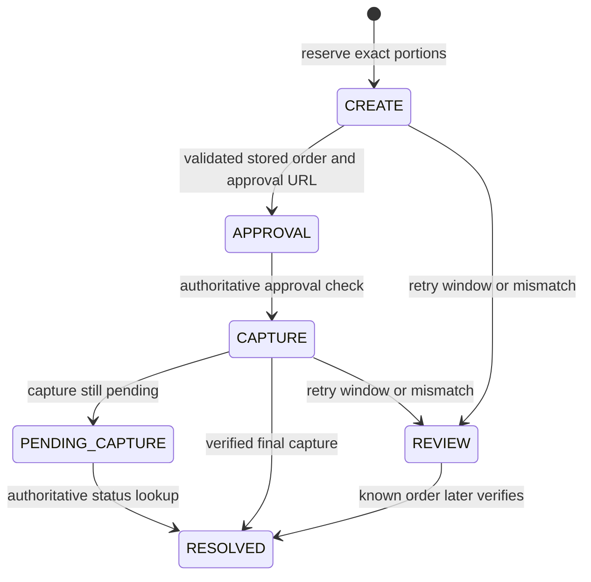

# Financial and AI boundaries

## Guest interface

The menu combines warm cream and forest colors, serif headings, a large food photograph, category controls and photo cards. It uses the same 228-entry, 17-category catalog, localized dish names, availability flags, prices and real ordering actions. Photos remain illustrative; the existing allergens and dietary information remain visible in dish details.

The EUR guest dinner uses a compact demo toolbar, receipt photos, the current diner's share, everyone else's current balances and an Order → Review split → Agree → Pay progress indicator. Current and proposed amounts appear together in the AI preview; agreement badges reflect actual required voters. A mobile navigation bar provides Menu, My order, Pay & split and More. Switching demo diners selects the guest route, and section navigation scrolls to the top. Other workspaces retain their existing navigation. The hackathon profile hides practice-reservation links because their endpoint is available only in the local/demo profiles; those profiles retain the links.

These views read the existing session and proposal state. Editing an interpreted instruction or changing the table invalidates confirmation. A proposed allocation does not replace current balances before all required votes, and checkout continues to use the existing server reservation and PayPal verification flow. The redesign introduces no backend or financial contract changes.

## PayPal state machine

`POST /api/sessions/{sid}/paypal` calculates the payer's eligible portions on the server under the session lock. It persists a PROCESSING reservation, a PAYPAL_SANDBOX attempt, immutable merchant/currency/amount, and distinct create/capture UUID request IDs in the same idempotent command transaction.

The worker claims a two-minute lease in a short transaction, calls PayPal outside the transaction, then reacquires the session lock and applies the response only if its lease still owns the attempt. Expired leases permit recovery after a process restart. All lifecycle mutations serialize on the table session.

Create and capture use persistent, distinct `PayPal-Request-Id` values. At five hours from the first possible dispatch, the application stops repeating that mutation, conservatively inside PayPal's documented default six-hour retention. It never invents a new key to retry an uncertain operation. Known orders in REVIEW continue GET-only polling. Missing/failed responses do not release money reservations. [PayPal idempotency](https://developer.paypal.com/api/rest/reference/idempotency/).

Before settlement, the response must identify the stored order, exactly one purchase unit, local payment UUID (`custom_id`), intended merchant, EUR, and exact bill-plus-tip gross. A single nested capture must have the correct gross/currency, stable capture ID and a recognized final status. Mismatches remain reserved. Existing settlement constraints and terminal-state checks ensure only the original reserved portions are settled once; tips do not reduce the bill.

Cancellation before any capture dispatch invalidates the lease and releases the attempt under the same session lock. After capture may have been dispatched, cancellation records intent but keeps the reservation while checking PayPal. A verified completed capture wins over a concurrent cancellation request. Browser return/cancel query parameters have no financial authority. No webhooks or PayPal refunds are implemented. Generic simulator, manual collection, reconcile and refund routes reject PayPal attempts.

An approved order is polled even if the browser closes. An unresolved attempt may remain protected indefinitely when provider truth is unavailable; this is deliberate. The operator must investigate without editing ledger balances or bypassing verification. Polling is suitable for this bounded demo, not a claim of production-grade payment operations.

## AI interpretation and consent

`POST /ai-splits/preview` checks guest authorization and a revision-bound accepted-item snapshot. Duplicate dish/diner names trigger local clarification when references are omitted. The external service receives untrusted data inside a bounded snapshot; it has no tools and receives no credentials. The Responses API uses a strict JSON schema; only ASSIGN, EQUAL and positive integer WEIGHTS instructions are accepted.

The backend validates actual table references, active guests, responsibility authorization and item eligibility. Money.weighted computes exact amounts with stable largest-remainder rounding. An AI summary never controls money. Preview persistence includes the interpretation and current revision; no financial proposal exists yet. The returned preview shows each referenced item's shares, resulting full diner allocations and required voters.

Confirmation requires the same actor, same table revision, an unexpired 15-minute draft, and renewed validation. One atomic AI_SPLIT proposal enters the pre-existing consent machinery. The proposer consents on confirmation. All affected old/new share owners must agree. A stale preview cannot be confirmed by supplying a newer revision; it requires a new preview. Paid or reserved items cannot be reassigned.

AI usage is reserved before the external request with a cumulative database cap and a 20-per-diner hourly limit. Same-key replay returns the saved result without a second paid call. A crash after dispatch but before saving the result consumes one allowance and returns a safe clarification on replay; a new interpretation requires an explicit new preview. Provider failure, malformed output and refused/ambiguous requests leave allocations unchanged.

## Currency and data isolation

Restaurant currency is immutable in both application modeling and a database trigger. Existing restaurants stay MDL; the hackathon profile creates only a separate EUR fixture. Session views, account visit history, POS snapshots, payment attempts, confirmations and frontend amounts use restaurant/payment currency. Legacy `_bani` fields represent integer minor units. Currency conversion is outside scope.

The hackathon profile cannot be combined with local/demo, requires generated secrets, disables simulator payment capability, and uses a separate Compose database. Existing dependency licenses and notices remain in their packages; the root MIT license applies to Mihai Bargan's original project code.
